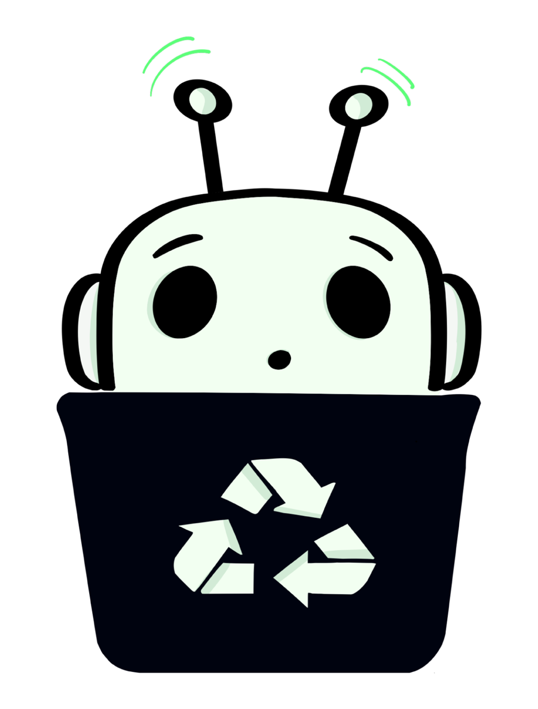
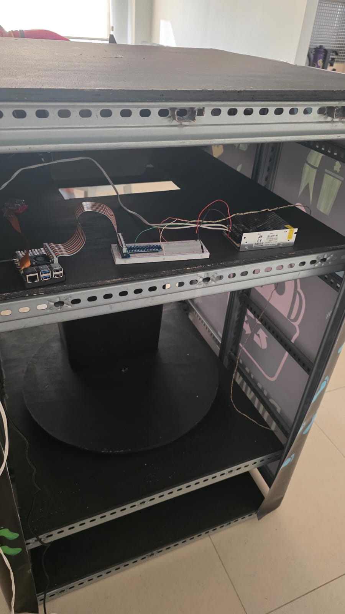
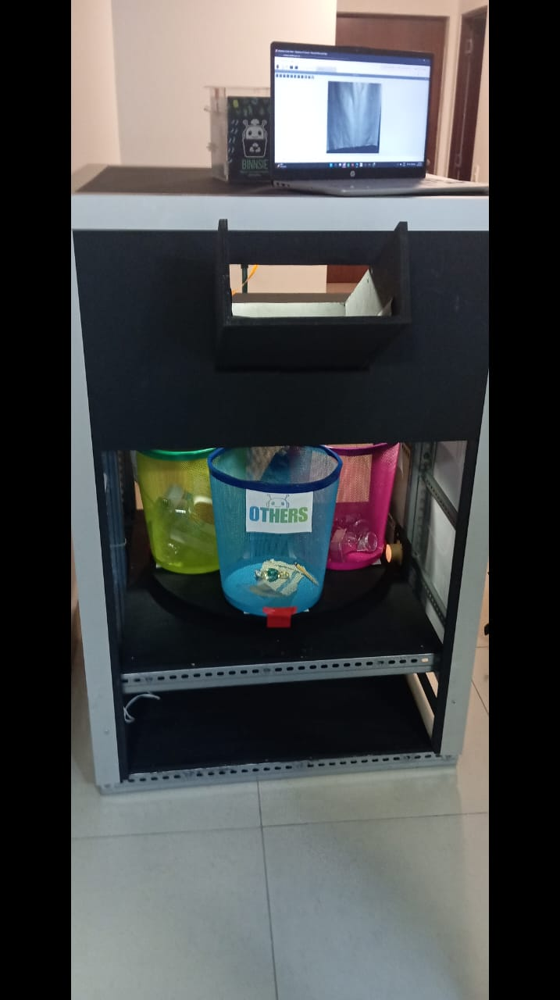
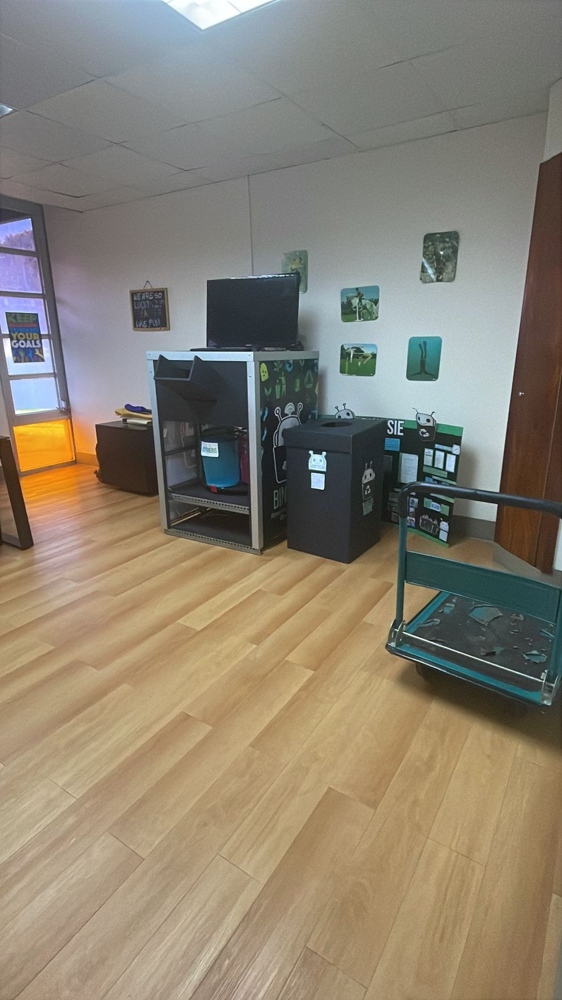
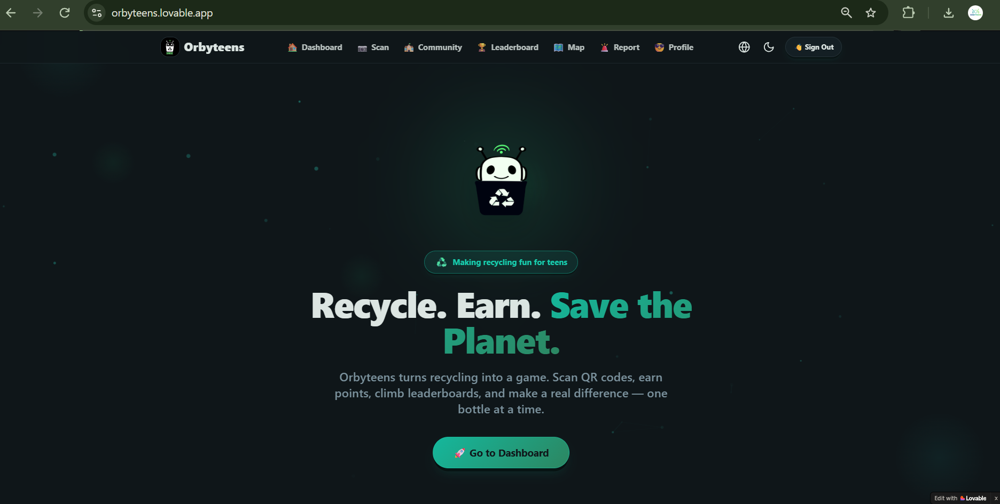

  

<h1 align="center">BINNSIE</h1>

  <strong>The bin sorts, the student learns.</strong>

  <em>An educational smart recycling ecosystem combining engineering, artificial intelligence, and environmental education.</em>

---

## About BINNSIE

BINNSIE is an educational smart recycling project developed to improve waste separation at the source and encourage sustainable habits in schools.

The project addresses a challenge that goes beyond the disposal of waste: recyclable materials are often mixed, contaminated, or incorrectly classified, making their recovery more difficult.

BINNSIE explores how technology can make recycling easier and more engaging by combining an intelligent physical recycling station, computer vision, digital tools, and student participation.

**BINNSIE is more than a recycling bin or an application. It is an ecosystem designed to connect waste separation with education.**

## Target Audience

BINNSIE is designed primarily for **schools and school communities**, with a focus on **children, adolescents, and students** who can learn and build better recycling habits through everyday interaction. Teachers, school staff, and administrators are also important participants because they help make environmental learning part of the school experience.

The project is being developed with school environments in mind. Its educational approach is intended to make waste separation easier to understand, more visible, and more engaging for young people.

## How BINNSIE Began

The idea for BINNSIE began with an everyday experience. While having a meal at a restaurant, our team wanted to dispose of recyclable waste in the containers provided for that purpose. However, when we looked inside the recycling-labeled containers, we found different types of waste mixed together, just as they might be in an ordinary trash bin.

That moment raised a question: **what is the point of labeling recycling containers if the materials end up mixed anyway?**

We began investigating the situation further and visiting other recycling containers around Panama. We also researched waste management, recycling practices, and the barriers that prevent recyclable materials from being properly separated and recovered. These investigations suggested that what we had seen was not an isolated incident, but part of a recurring problem: recycling infrastructure alone does not guarantee correct separation. Awareness, guidance, consistent practices, and appropriate handling after collection matter too.

The research compiled for BINNSIE's supporting documents describes the broader context in Panama, including an estimated **4,800 tons of solid waste generated per day**, approximately **380,000 tons of plastic waste per year**, and a formal recycling rate reported as **below 10%**. These figures are included as background indicators in the project's supporting materials; readers can consult those documents for their context and references.

We also conducted a community survey with **46 respondents**. In that survey, **97.8%** considered recycling important, **19.6%** reported recycling consistently, and **80.4%** said they would recycle more if the process were automatic. These responses are an initial local validation exercise, not a nationally representative survey. A separate review of institutions in the Panamá Pacífico area found that 20% had a manual recycling system, while 80% did not report having one.

The STEAM Fair work contributed to the project's development record by documenting the evolution of the physical prototype, design decisions, construction process, challenges, tests, and improvements. Together with the research and field observations, this process helped shape BINNSIE's central idea: **the system should help sort the materials while students learn why proper recycling matters.**

For further context, see the [project overview and supporting documents](docs/README.md).

## The Problem

Improper waste management remains an important environmental challenge in Panama.

Limited source separation, contamination of recyclable materials, and difficulties in establishing consistent recycling habits all contribute to the problem.

Recycling requires more than asking people to separate their waste. It also requires accessible systems, clear guidance, appropriate infrastructure, and reliable material management.

BINNSIE aims to address these challenges through an educational and technology-based approach.

## Our Approach

BINNSIE combines five main areas:

### 1. Physical Engineering

   
  
  

An intelligent recycling station designed to receive waste and direct materials into designated compartments through a mechanical sorting system.

The physical prototype incorporates a structural frame, collection compartments, a camera, and motorized mechanisms.

### 2. Artificial Intelligence

A computer-vision system designed to identify recyclable materials and support automatic classification.

The current model works with three material classes:

- Metal
- Paper
- Plastic

The AI development process includes image collection, dataset preparation, model training, and performance evaluation.

### 3. Digital Application

   

A web application prototype developed with Lovable, React, TypeScript, Vite, Tailwind CSS, and Supabase.

[Open the BINNSIE application](https://orbyteens.lovable.app/)

It explores features such as:

- User profiles and recycling activity.
- Points and achievements.
- Community participation and rankings.
- Recycling location maps.
- Reports about recycling locations.
- Educational information.
- Administrative and organizational tools.

The application is currently developed separately from the physical hardware prototype.

### 4. Education and Engagement

BINNSIE aims to make recycling an interactive learning experience.

Through gamification, educational content, and immediate feedback, the project encourages students to understand the importance of proper waste separation and develop more sustainable habits.

A physical feedback display is also part of the project’s future development plans.

### 5. Recycling Management

Proper separation is only one step in the recycling process.

BINNSIE recognizes the importance of collection, transportation, and appropriate treatment of recovered materials. Collaboration with recycling centers and material-management partners is an important area for further development.

## How It Works

The intended system workflow is:

1. A user places a recyclable item into the station.
2. A camera captures an image of the item.
3. The computer-vision model analyzes and classifies the material.
4. The classification guides the mechanical sorting mechanism.
5. The item is directed toward its designated compartment.
6. Digital and educational tools can support user participation and engagement.

The complete workflow is an ongoing development objective. Not every component is currently integrated into a single operational system.

## Technology

The project has explored and used technologies across different areas:

| Area | Technologies |
|---|---|
| Hardware | Raspberry Pi 5, camera, servo motors, sensors |
| Artificial Intelligence | Python, Ultralytics, YOLO, Roboflow |
| Model Training | Google Colab |
| Digital Application | Lovable, React, TypeScript, Vite, Tailwind CSS |
| Backend and Database | Supabase |
| Physical Design | Mechanical construction and prototyping |

This list describes technologies used or explored during development. It does not imply that every component is part of a finalized deployment.

## Development Status

BINNSIE is an evolving project. Its components are at different stages of development.

| Component | Current status |
|---|---|
| Physical recycling station | Prototype built and tested |
| Mechanical sorting | Implemented in the prototype; undergoing refinement |
| Artificial intelligence | Trained model undergoing improvement |
| Digital application | Experimental web application prototype |
| Educational experience | Under development |
| Physical feedback display | Future development |
| Recycling partnerships | Further development and validation needed |

Further testing in real school environments is necessary to evaluate the system’s reliability, usability, and educational impact.

## Getting Started: Explore BINNSIE

You can explore the project without installing any software:

1. **Start here:** Read this README to understand BINNSIE’s purpose, approach, and current development status.
2. **Explore the documentation:** Visit the [documentation index](docs/README.md) for the project overview and supporting documents.
3. **See the digital prototype:** Open the [BINNSIE application](https://orbyteens.lovable.app/) to explore its current interface and experimental features. The app is a separate prototype and is not yet integrated with the physical station.
4. **Look at the prototype:** Review the photos in the assets folder to see selected views of the physical station and its components.
5. **Learn how to contribute:** Read [CONTRIBUTING.md](CONTRIBUTING.md) before suggesting changes or opening a pull request.

The public repository intentionally does not include every internal file, dataset, model weight, credential, or technical configuration. You do not need access to those materials to understand the project or provide feedback.

## Next Development Steps

The following are planned priorities. They are development goals, not claims that the work has already been completed:

- **Improve the AI model:** Continue evaluating and refining material detection for Metal, Paper, and Plastic.
- **Refine the mechanical system:** Improve the sorting mechanism’s reliability and consistency.
- **Validate in a school environment:** Plan supervised testing to assess usability, classification performance, and the quality of material separation.
- **Connect the ecosystem:** Work toward integrating the physical station, AI model, and digital application.
- **Strengthen the educational experience:** Develop clearer learning activities and engagement features for students.
- **Build recycling partnerships:** Identify and validate collection and recycling partners so recovered materials can be handled appropriately.

Progress will depend on prototype testing, feedback from potential users, technical improvements, and collaboration with schools and recycling partners.

## Project Vision

Our vision is to develop a replicable educational recycling system that helps schools improve waste separation while encouraging students to participate actively in environmental solutions.

We believe that technology can support better recycling practices when it is combined with education, accessible infrastructure, and responsible material management.

## Collaboration

We welcome constructive feedback, technical suggestions, and contributions that can help improve BINNSIE.

Areas of interest include:

- Mechanical and hardware engineering.
- Artificial intelligence and computer vision.
- Embedded systems and programming.
- Educational technology and user experience.
- Recycling practices and material management.
- Testing and technical documentation.

Please open an issue to suggest an improvement, report a problem, or discuss a potential contribution.

## Use of AI Tools

ChatGPT was used as a support tool during the preparation and editing of project documentation, including help with organizing information, improving clarity, and reviewing written explanations. The project decisions, descriptions, and development status were reviewed by the project creator. AI assistance does not replace the project’s own research, design, testing, or validation.

## Repository Scope

This public repository presents BINNSIE’s concept, development, documentation, and selected project materials.

Not all internal implementation files, software components, datasets, or technical configurations are included.

Please review the repository documentation before proposing contributions.

---

  <strong>BINNSIE</strong> 
  <em>The bin sorts, the student learns.</em>

