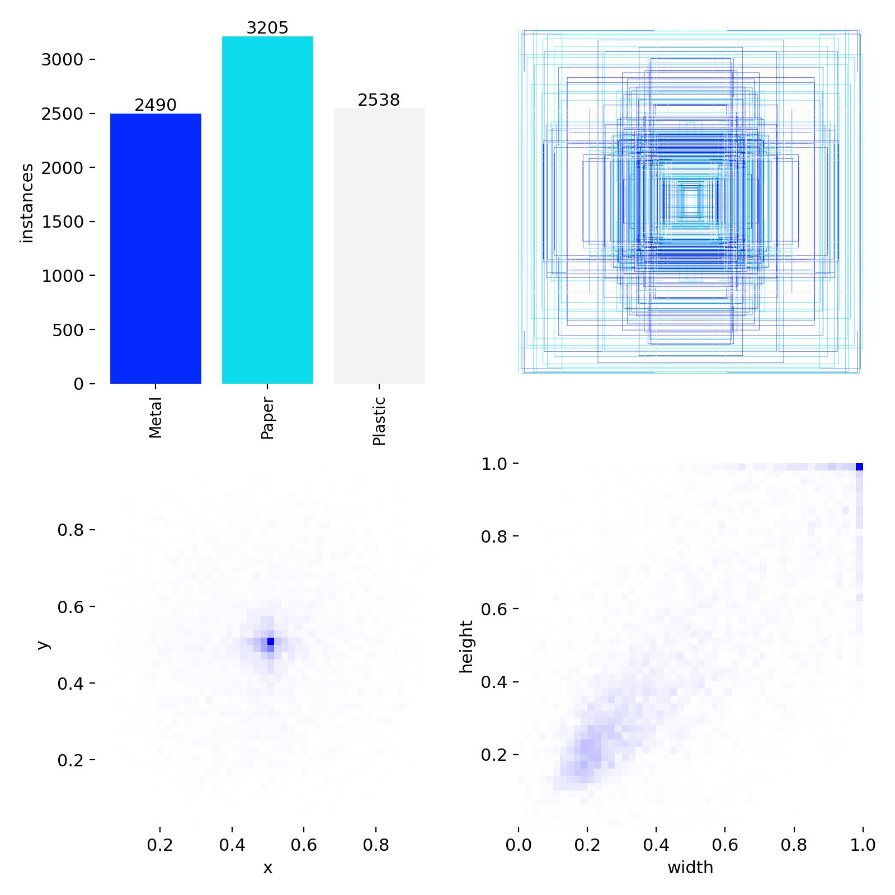
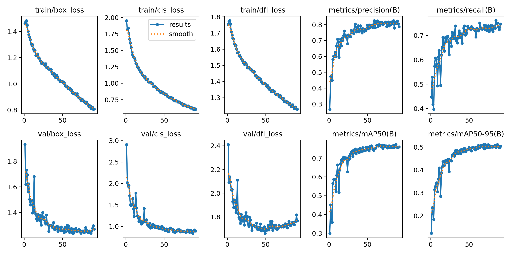
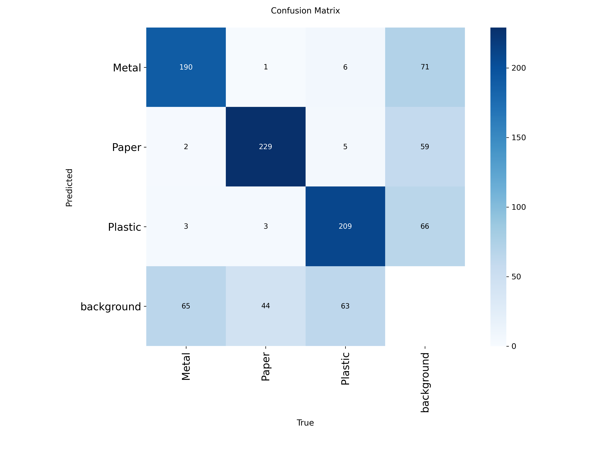
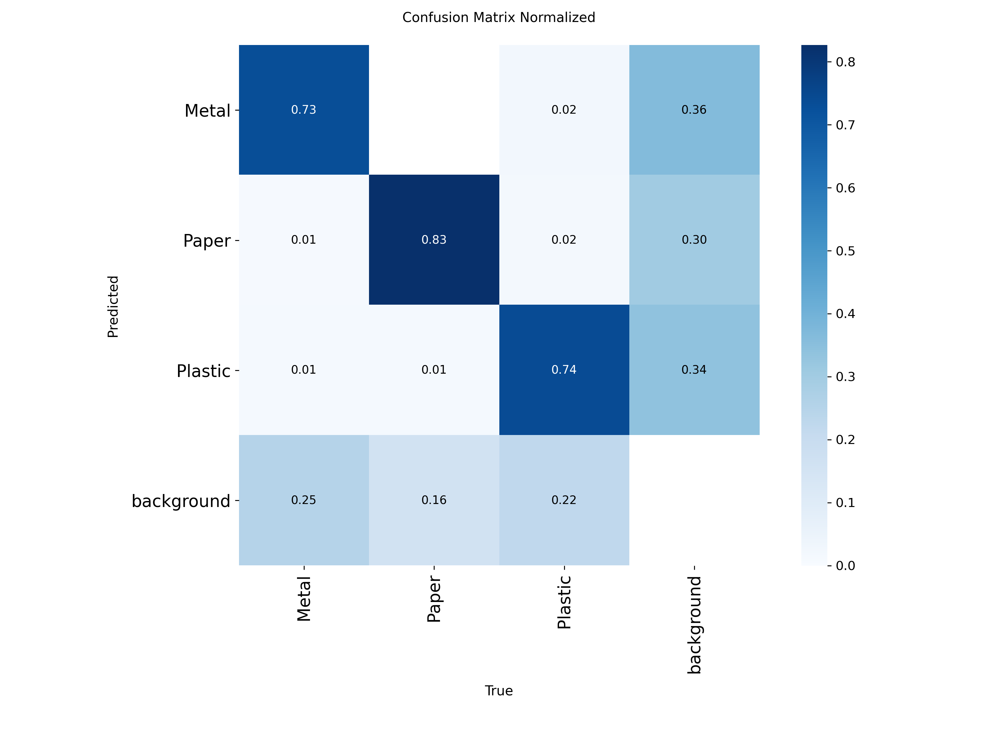
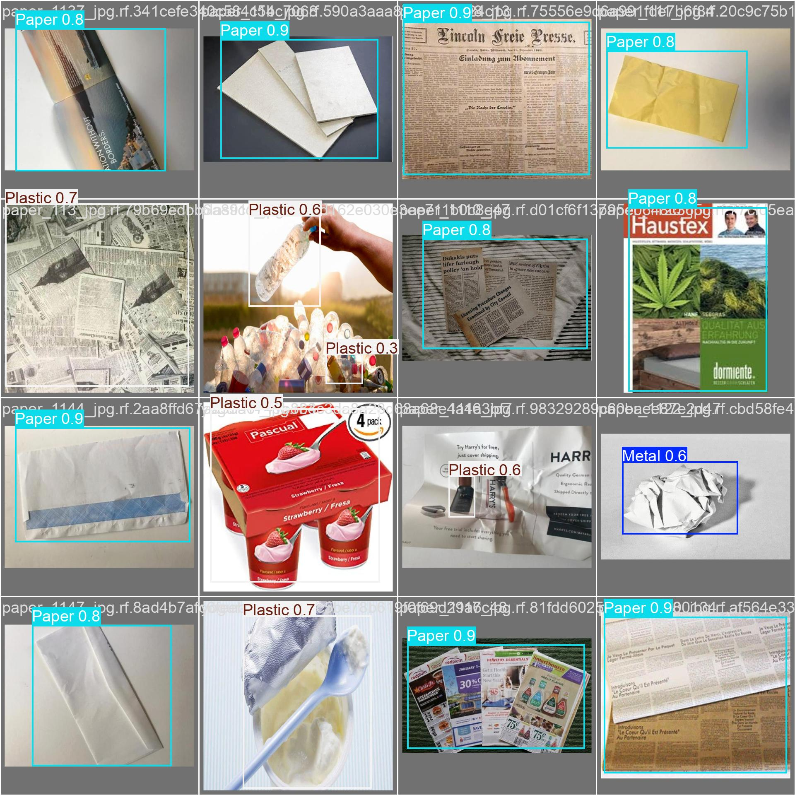
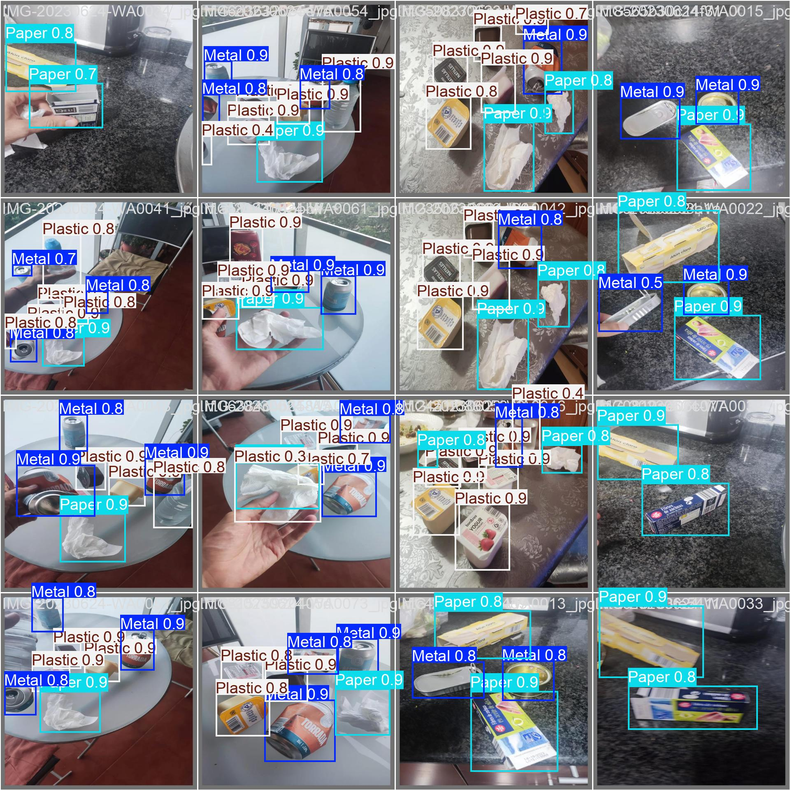
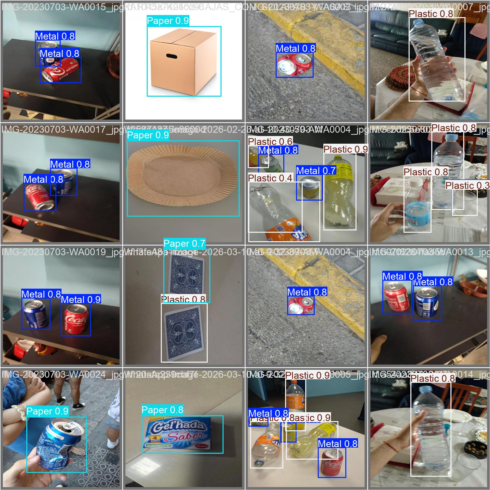

# BINNSIE AI — Training Methodology

## 1. Overview

This document presents the visual development process of BINNSIE AI, from dataset preparation to model training and validation.

The purpose is to document the actual development work through training outputs, dataset visualizations, and model predictions.

The current experiment used YOLOv8s and was trained in Google Colab.

## 2. Dataset Preparation

The dataset used in the current experiment contains 4,001 images.

The original annotation categories were:

- Metal
- Paper
- Plastic
- None

The `None` category was used for images without annotated recyclable objects. During testing, the team identified classification confusion associated with this category and decided to remove it from a future dataset revision.

### Dataset annotations

  

<em>Figure 1. Dataset labels and object annotation distribution.</em>

## 3. Model Training

The model was trained using Ultralytics YOLOv8s in Google Colab with an NVIDIA Tesla T4 GPU.

The experiment was initially configured for 130 epochs. Training stopped after 91 epochs due to early stopping. The best checkpoint was obtained at epoch 71.

### Training performance

  

<em>Figure 2. Training and validation metrics generated during the experiment.</em>

The training graphs provide a visual record of the learning process, including loss curves and evaluation metrics.

## 4. Training Image Samples

The following images show examples of batches processed during training.

  

<em>Figure 3. First training batch.</em>

  

<em>Figure 4. Second training batch.</em>

  

<em>Figure 5. Third training batch.</em>

## 5. Validation and Error Analysis

After training, the model was evaluated using a separate validation dataset.

The confusion matrices help visualize the relationship between predicted and actual categories and identify classification errors.

### Confusion matrix

  

<em>Figure 6. Confusion matrix generated during validation.</em>

### Normalized confusion matrix

  

<em>Figure 7. Normalized confusion matrix.</em>

## 6. Validation Predictions

The following images show examples of predictions generated on validation batches.

### Validation batch 0

  

### Validation batch 1

  

### Validation batch 2

  

These examples provide a visual reference for how the model detects and classifies recyclable objects during validation.

## 7. Raspberry Pi 5 Testing

The trained model was also tested on Raspberry Pi 5, the intended edge-computing platform for BINNSIE.

Preliminary testing revealed that recognition performance varies depending on:

- Lighting conditions.
- Object orientation and positioning.
- Camera viewing angle.
- Differences in object appearance.

The model occasionally fails to recognize objects or confuses material categories.

These observations motivated the planned collection of additional images directly using the Raspberry Pi Camera.

## 8. Future Training Improvements

Future development will focus on:

- Capturing additional images using the Raspberry Pi Camera.
- Collecting examples under different lighting conditions.
- Including different object orientations and viewing angles.
- Reviewing difficult detection examples.
- Removing the problematic `None` category from a future dataset revision.
- Retraining and comparing future model versions.
- Evaluating detection consistency on Raspberry Pi 5.

## 9. Related Documentation

- [ML Overview](README.md)
- [Model Card](MODEL-CARD.md)
- [Dataset Card](DATASET-CARD.md)

---

*This document presents the current documented training experiment. The images and results correspond to the development process and do not represent guaranteed performance in a fully operational recycling station.*

**BINNSIE — The bin sorts, the student learns.**
