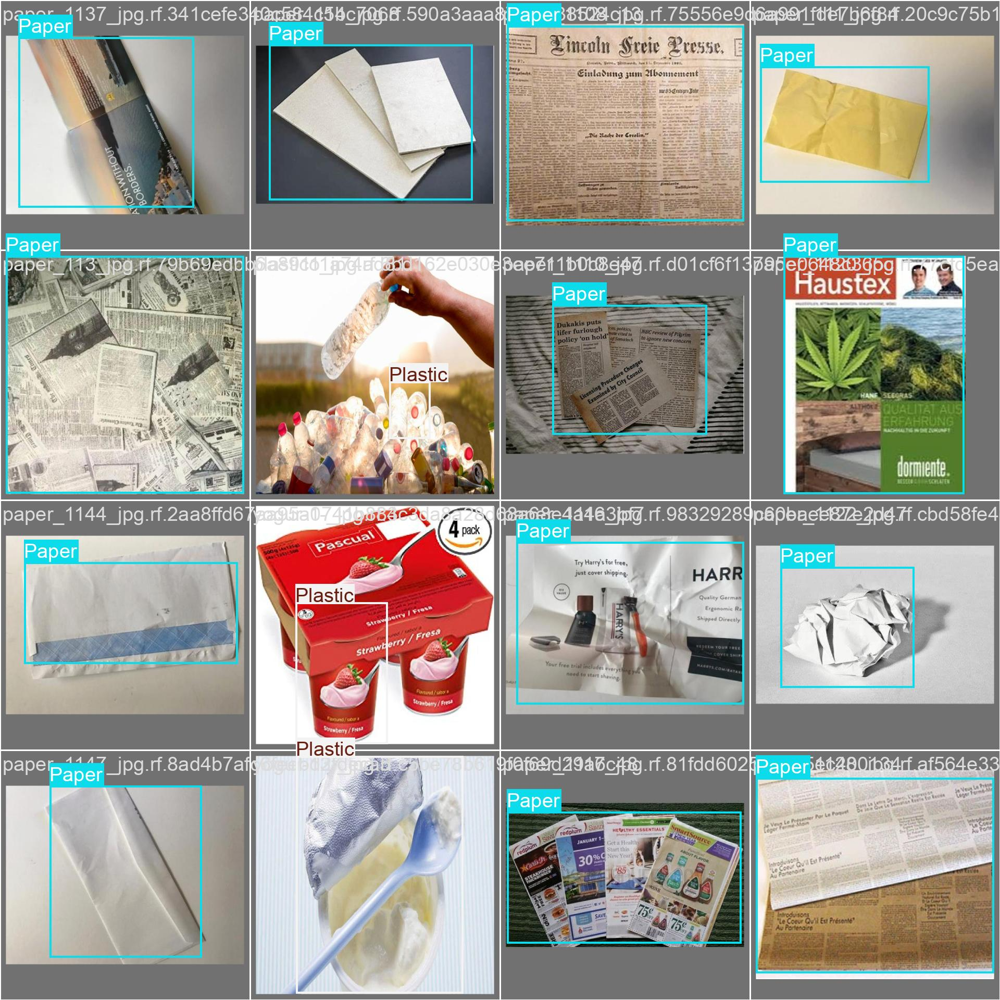
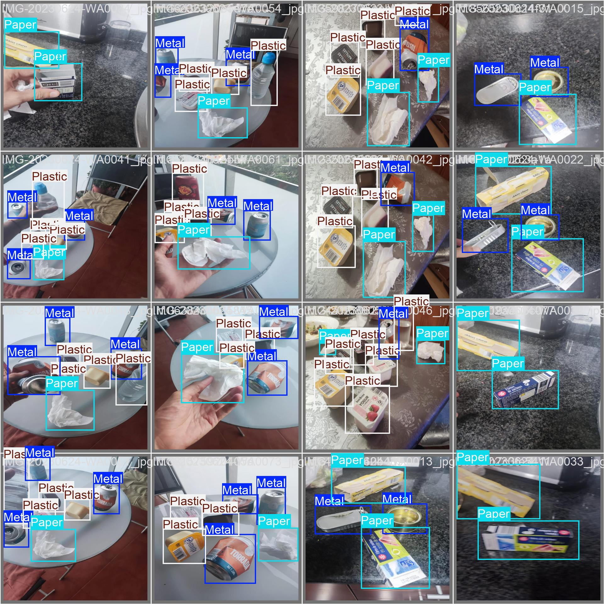
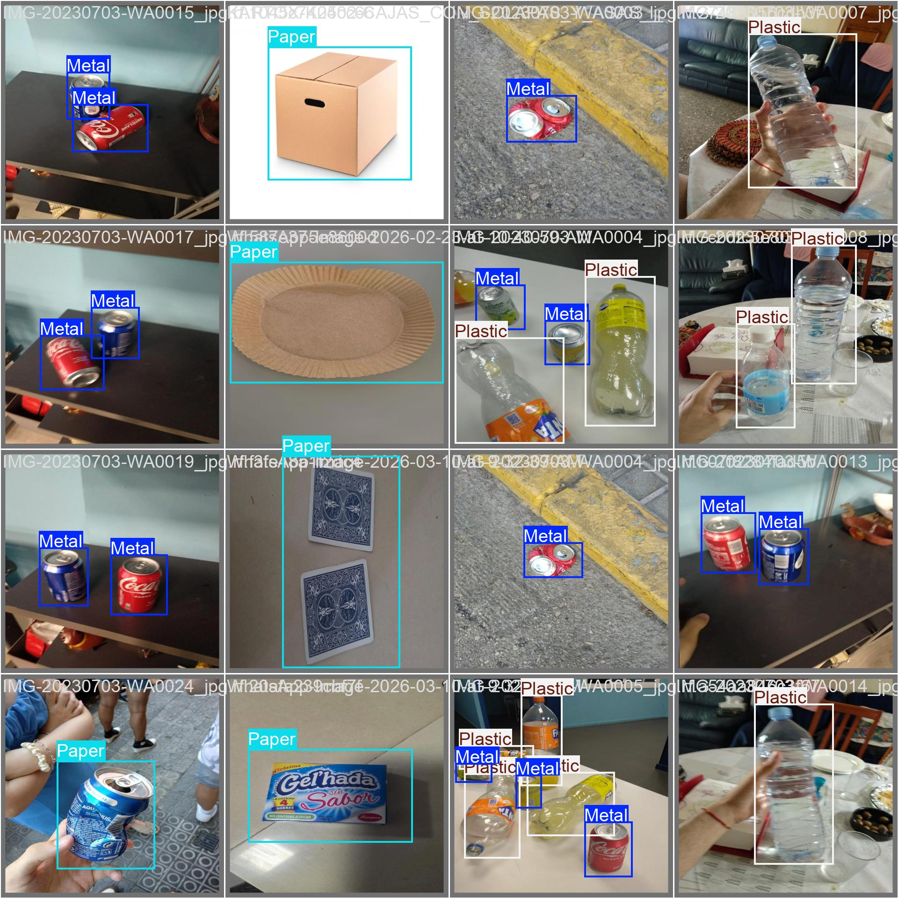

# BINNSIE AI — Training Methodology

## 1. Overview

This document presents the visual development process of BINNSIE AI, from dataset preparation to model training and validation.

It uses outputs generated during the actual Ultralytics training experiment to show how the dataset was prepared, how the model training progressed, and how its predictions were reviewed.

The current experiment used YOLOv8s and was trained in Google Colab.

## 2. Dataset Preparation

The dataset used in the current experiment contains 4,001 images.

The original annotation categories were:

- Metal
- Paper
- Plastic
- None

The `None` category was used for images without annotated recyclable objects. During testing, the team identified classification confusion associated with this category and decided to remove it from a future dataset revision.

### Dataset annotations

  

<em>Figure 1. Dataset label distribution and object annotation visualization generated during training preparation.</em>

## 3. Model Training

The model was trained using Ultralytics YOLOv8s in Google Colab with an NVIDIA Tesla T4 GPU.

The experiment was initially configured for 130 epochs. Training stopped after 91 epochs due to early stopping. The best checkpoint was obtained at epoch 71.

### Training performance

  

<em>Figure 2. Training and validation metrics generated by Ultralytics during the experiment.</em>

The plots provide a visual record of the training process, including loss curves and evaluation metrics.

## 4. Validation and Error Analysis

The confusion matrices generated during validation help visualize how the model's predictions compare with the annotated classes. They can also help identify categories that may be confused.

### Confusion matrix

  

<em>Figure 3. Confusion matrix generated during validation.</em>

### Normalized confusion matrix

  

<em>Figure 4. Normalized confusion matrix.</em>

## 5. Validation Predictions

The following images provide examples from the validation batches. Each pair shows the annotated labels and the model predictions for the same batch.

### Validation batch 0

  

<em>Figure 5. Ground-truth annotations for validation batch 0.</em>

  

<em>Figure 6. Model predictions for validation batch 0.</em>

### Validation batch 1

  

<em>Figure 7. Ground-truth annotations for validation batch 1.</em>

  

<em>Figure 8. Model predictions for validation batch 1.</em>

### Validation batch 2

  

<em>Figure 9. Ground-truth annotations for validation batch 2.</em>

  

<em>Figure 10. Model predictions for validation batch 2.</em>

These paired examples make it possible to visually compare the model's predictions with the corresponding annotations. They are illustrative examples and do not replace the quantitative evaluation documented in the Model Card.

## 6. Raspberry Pi 5 Testing

The trained model was also tested on Raspberry Pi 5, the intended edge-computing platform for BINNSIE.

Preliminary testing revealed that recognition performance varies depending on:

- Lighting conditions.
- Object orientation and positioning.
- Camera viewing angle.
- Differences in object appearance.

The model occasionally fails to recognize objects or confuses material categories.

These observations motivated the planned collection of additional images directly using the Raspberry Pi Camera.

## 7. Future Training Improvements

Future development will focus on:

- Capturing additional images using the Raspberry Pi Camera.
- Collecting examples under different lighting conditions.
- Including different object orientations and viewing angles.
- Reviewing difficult detection examples.
- Removing the problematic `None` category from a future dataset revision.
- Retraining and comparing future model versions.
- Evaluating detection consistency on Raspberry Pi 5.

## 8. Related Documentation

- [ML Overview](README.md)
- [Model Card](MODEL-CARD.md)
- [Dataset Card](DATASET-CARD.md)

---

*This document presents the current documented training experiment. The images and results correspond to the development process and do not represent guaranteed performance in a fully operational recycling station.*

**BINNSIE — The bin sorts, the student learns.**
